# 沖繩右駕模擬器 健檢報告（2026-11-16）

> 範圍：只看不改。對象是 `index.html`（2,245 行）、`README.md` 和 7 月的優化紀錄 `TASK-sim-optimize.md`。
> 實測：線上版 https://sobadrush.github.io/okinawa-right-hand-drive-simulator/ （與本機 `index.html` 的 md5 相同：`1f06a336…`）。
> 用 Playwright 加 Chrome（SwiftShader 軟體 WebGL）實際開車：桌機 1280×800，手機直式 390×844、橫式 844×390（`isMobile`、`hasTouch`、DPR 2，用 CDP 觸控事件按住按鈕）。
> 已排除 7 月做過的項目：delta-time 物理、Retina、場景強化、星等、超速、第 10 關、視角切換、手機觸控、Audi R8 玩家車。
> 標示「推測」的項目是沒有實測驗證的。

---

## 總覽表

| # | 方向 | 項目 | 優先 | 工作量 |
|---|---|---|---|---|
| A1 | 畫面 UI／UX | 頂部 HUD 在停止線前遮住紅綠燈和「止まれ」標誌 | **P0** | S |
| A2 | 畫面 UI／UX | 手機直式水平視角只有 33°，看不到行人和路口左右 | **P0** | S |
| A3 | 畫面 UI／UX | 桌機儀表板排版破碎（鍵位提示一字一行、「安全分」斷行） | P1 | S |
| A4 | 畫面 UI／UX | 教學引導不足：導引線預設關閉，說明卻叫玩家「依循綠色引導線」 | P1 | S |
| A5 | 畫面 UI／UX | 手機觸控目標和字級太小（方向燈 34×34、HUD 10px） | P1 | S |
| A6 | 畫面 UI／UX | 主要按鈕對比不足（開始鈕 2.43:1、「油」3.22:1） | P1 | S |
| A7 | 畫面 UI／UX | 過關／失敗回饋太籠統，HUD 不反映方向燈狀態 | P1 | M |
| A8 | 畫面 UI／UX | 無障礙：沒有 reduced-motion、靜音和按鈕 aria-label | P2 | S |
| B1 | 遊戲性與關卡 | 沒有邊界和逾時：開錯方向會永遠卡在關卡裡，甚至開出地圖 | **P0** | S |
| B2 | 遊戲性與關卡 | 紅綠燈左右順序與日本法規相反（紅燈在左） | **P0** | S |
| B3 | 遊戲性與關卡 | 場景誤導：所有關卡都有「止まれ」；第 7 關對向車停在我方斑馬線上 | P1 | S |
| B4 | 遊戲性與關卡 | 難度曲線平：10 關在同一路口，3 種路徑重複，號誌不會變 | P1 | M |
| B5 | 遊戲性與關卡 | 缺少沖繩在地情境關卡（巴士專用道、左轉捲入機車等） | P1 | L |
| B6 | 遊戲性與關卡 | 部分判定與法規教學有疑慮（閃黃燈停車即判失敗等） | P1 | S |
| B7 | 遊戲性與關卡 | 計分是跨關累積，和星等脫鉤，沒有結算與錯題回顧 | P2 | M |
| C1 | 操控手感 | 鍵盤沒有方向燈快捷鍵，必須放開方向鍵改用滑鼠點 | **P0** | S |
| C2 | 操控手感 | 按鍵會卡住：切視窗或按 Shift 後放開，車子會自己一直加速 | **P0** | S |
| C3 | 操控手感 | 煞車太瞬間（38→0 只花 0.22 秒），滑行阻力又太大 | P1 | S |
| C4 | 操控手感 | 速度單位與世界比例不一致，進場距離太短（全油門 2.2 秒就到停止線） | P1 | M |
| C5 | 操控手感 | 停車位置沒有回饋：停早了沒有提示，停止線被引擎蓋擋住 | P1 | S |
| C6 | 操控手感 | 轉向只有數位開關，手機只能用 ◀ ▶ | P1 | M |
| C7 | 操控手感 | 缺少右駕特有手感：右側方向燈撥桿、左側雨刷誤觸 | P2 | M |

各方向項目數：**A 8 項、B 7 項、C 7 項**，共 22 項，其中 P0 有 6 項。

## 建議優先做的前 3 項

1. **A1 HUD 遮擋號誌**：這是號誌教學遊戲，玩家卻在最關鍵的停止線前看不到燈。改成開車時收合關卡卡片並移開指示條，工作量 S。
2. **B2 紅綠燈順序反了**：日本橫式燈依法是「左青、中黃、右赤」，目前紅燈在左。修正只要對調兩顆燈的 x 座標（S），卻能直接避免教錯。
3. **A2 手機直式視角太窄**：直式水平視角只有 33°，第 10 關的行人大半時間都在畫面外。依螢幕比例動態調整 FOV 即可（S），手機玩家才看得到要禮讓的對象。

> 緊接在後的 P0：**B1**（開錯方向會卡關）、**C1／C2**（鍵盤方向燈快捷鍵與卡鍵）。五項都是 S，可以一起排一個小版本。

---

## A. 畫面與 UI／UX

### A1. 頂部 HUD 在停止線前遮住紅綠燈和「止まれ」標誌（P0／S）
- **現況與證據**
  - 桌機在第 3 關停止線前（z≈20）煞停時，HUD 指示條正好蓋住整組紅綠燈，只露出燈桿：`health-check-img/desktop-03-l3-hud-covers-signal-at-stopline.webp`。
  - 第 1 關過停止線時，燈被關卡卡片右下角切掉一半：`desktop-02-l1-hud-covers-signal-guidance-faint.webp`。
  - 「止まれ」三角牌被關卡卡片左上角遮住：`desktop-04-l3-stopped-early-no-feedback.webp`。
  - 手機點開 ℹ️ 說明後，指示條往下推，壓到號誌：`mobile-04-info-expanded-covers-signal.webp`。
  - 橫式手機的指示條緊貼燈頂（燈在 y≈113，指示條底部在 y=102），儀表板兩塊卡片又疊在路面中央：`landscape-01-l7-hud-dash-cover-road.webp`。
  - 版面：`#hudTopArea` 固定在畫面頂部 `top-6`（第 137–192 行）。卡片寬 672、高 134px，下方再接 56px 高的指示條，合計約占桌機畫面上方 230px。
- **建議做法**
  - 開車後（`isDriving`）自動把關卡卡片收合成一行標題。
  - 指示條移到畫面下方、儀表板上緣，或靠左上角。
  - 車輛進入路口 30 單位內時，HUD 降到 30% 透明度。
  - 加分做法：在 HUD 裡放一個「目前號誌」小圖示，例如「🔴＋→」。
- **效益**：號誌是本作核心教學物件，看得到燈才有學習價值。

  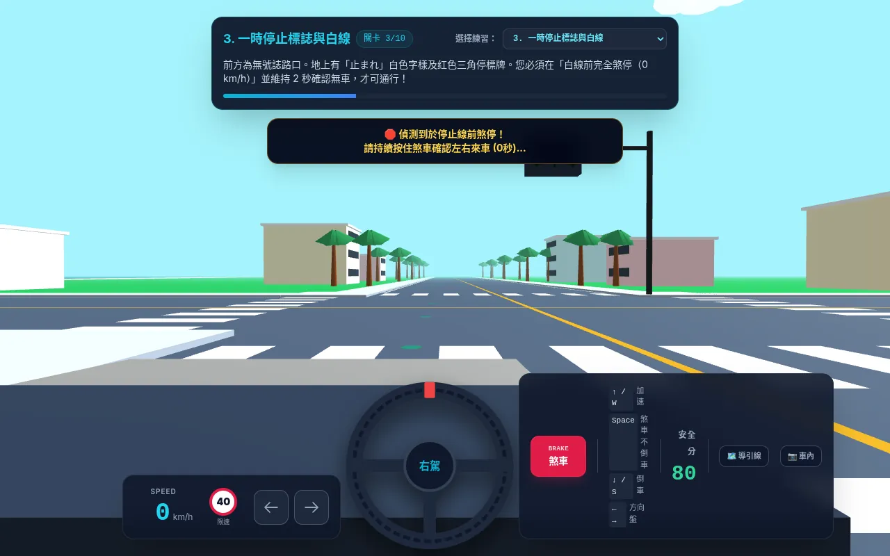
- **工作量**：S（純 CSS 加一個狀態 class）

### A2. 手機直式水平視角只有 33°，看不到行人和路口左右（P0／S）
- **現況與證據**
  - 相機固定垂直 FOV 65°（第 945 行，第 2174 行再隨車速加到 73°）。直式 390×844 換算水平 FOV 只有 **32.8°**（實測 `camera.fov` 和 `aspect`）。
  - 第 10 關停在斑馬線前時，行人要走到 x≈2 才進入畫面，走到 x≈-6.5 又離開，但判定「行人仍在路面」的範圍是 -9 到 9（第 805 行）。
  - 行人走到路中央時只露出半個身體在右緣：`mobile-06-l10-ped-at-road-center-edge.webp`。HUD 寫「已停車禮讓」，畫面上卻沒有行人：`mobile-05-l10-pedestrian-offscreen.webp`。
  - 對照橫式，行人清楚可見：`landscape-02-l10-pedestrian-visible.webp`。
  - 第 3 關停止區內，「止まれ」標誌和左右路口都在畫面外：`mobile-03-l3-portrait-narrow-fov.webp`。
- **建議做法**
  - `aspect < 1` 時改用「目標水平 FOV」反推垂直 FOV，例如水平固定 70–80°。
  - 或第一次進入直式時提示「建議橫放手機」。
  - 同時降低直式儀表板高度。
- **效益**：手機玩家能看到要禮讓的行人和左右來車，「一時停止確認左右」才有意義。

  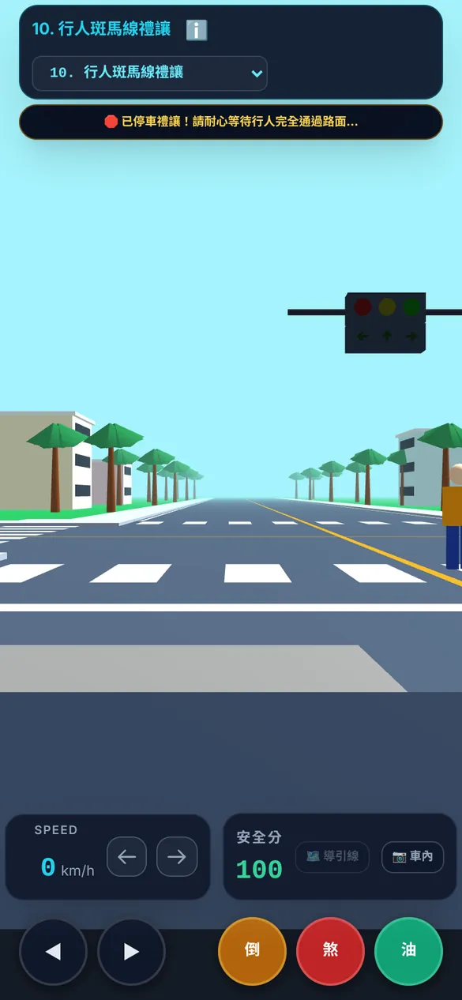
- **工作量**：S（`update3DCamera` 和 resize 各改幾行）

### A3. 桌機儀表板排版破碎（P1／S）
- **現況與證據**
  - 1280×800 下，右側儀表板的鍵位提示被擠成一字一行（「煞／車／不／倒／車」）：`desktop-01-l1-hud-overview.webp`。
  - 分數變成二位數後，「安全分」斷成兩行：`desktop-07-l7-signal-order-stopsign-npc.webp`、`mobile-03-l3-portrait-narrow-fov.webp`。
  - 對應第 258–263 行（`#keyboardHints`）和第 267–270 行。
- **建議做法**
  - 加 `whitespace-nowrap` 和固定欄寬。
  - 鍵位提示改成「?」說明浮層，或第一次開車時的提示卡，把儀表板空間還給畫面。
- **效益**：介面看起來更穩定專業，也減少右下角面板的遮擋面積。
- **工作量**：S

### A4. 教學引導不足：導引線預設關閉（P1／S）
- **現況與證據**
  - 導引線預設關閉（`guidanceVisible = false`，第 1851 行），但第 1 關說明寫「依循地面上的『綠色引導線』」（第 439 行）。新手看不到說明裡提到的東西。
  - 打開後的導引點是半徑 0.2、不透明度 0.65 的綠點（第 1738–1745 行），對路面對比只有約 **2.57:1**，轉彎時很難看清：`desktop-02-l1-hud-covers-signal-guidance-faint.webp`。
  - 開始畫面沒有操作教學。手機版只看得到 ◀ ▶ 倒 煞 油，沒有說明方向燈要點儀表板上的箭頭。
- **建議做法**
  - 第 1–2 關（或第一次遊玩）預設開啟導引線，之後的關卡預設關閉，當作「進階」。
  - 導引點改成較大的箭頭（chevron），對比至少 3:1。
  - 第一次開始時依裝置顯示 3 步驟操作提示：加速、打方向燈、煞車。
- **效益**：降低第一關的挫折感，教學文字和畫面一致。
- **工作量**：S

### A5. 手機觸控目標和字級太小（P1／S）
- **現況與證據**（390×844 實測 `getBoundingClientRect`）

  | 元件 | 尺寸 | 是否達 44×44 |
  |---|---|---|
  | ◀ ▶ 倒 煞 油 | 58×58 | ✅ |
  | 方向燈 ← → | **34×34** | ❌ 每個轉彎關都要按 |
  | 導引線、車內切換 | **63×27／53×27**（字 10px） | ❌ |
  | ℹ️ 展開鈕 | **28×16** | ❌ |
  | 關卡下拉 | 199×30 | ❌ 高度不足 |
  | HUD 指示文字 | **10px**（第 110 行） | 太小 |

- **建議做法**
  - 方向燈移到 ◀ ▶ 上方，做成 48px 的大按鈕（呼應真實方向燈撥桿在方向盤旁）。
  - 所有按鈕最小 44×44。
  - HUD 文字最小 13px。
- **效益**：減少單手操作誤觸，方向燈好按，「忘記打方向燈」的扣分才公平。
- **工作量**：S

### A6. 主要按鈕對比不足（P1／S）
- **現況與證據**（WCAG 2.x 公式計算，半透明色以深色儀表板 `#1e293b` 疊色估算）
  - 開始、下一關按鈕的白字疊在 `cyan-500` 漸層左端：**2.43:1**（第 296 行），未達 4.5:1。
  - 手機「油」：白字疊在 `emerald-500` 85% 上，**3.22:1**（第 38 行，字 13px）；「倒」4.30:1；「煞」5.91:1 ✅。
  - 導引線按鈕關閉時整顆 `opacity: .4`（第 60 行），估算約 **2.3:1**。
  - 其餘主要文字都通過，例如 HUD 琥珀字 13.99:1、超速警示 9.39:1。
- **建議做法**
  - 漸層改從 `cyan-700 #0e7490` 開始（白字 5.36:1）。
  - 「油」改用 `emerald-700 #047857`（5.48:1），「倒」改用 `amber-700 #b45309`（5.02:1）。
  - 關閉狀態改用「描邊加刪除線圖示」表示，不要降低整體透明度。
- **效益**：符合 WCAG AA，在戶外強光下也看得清楚。
- **工作量**：S

### A7. 過關／失敗回饋太籠統，HUD 不反映方向燈狀態（P1／M）
- **現況與證據**
  - 失敗彈窗不論原因，都附同一段提醒「1. 靠左行駛 2. 右轉繞大圈、左轉繞小圈」（第 1996 行）。例如第 3 關沒停好也顯示轉彎提醒：`desktop-05-l3-fail-modal-generic.webp`。
  - 過關彈窗只有星等和「挑戰下一關」，沒有「重玩拿 3 星」或「回關卡列表」：`desktop-08-l1-success-modal.webp`。
  - 已經打了左轉燈，HUD 仍顯示「請打『左轉燈』」：`mobile-02-indicator-on-hud-still-asks.webp`。原因是第 450–451 行的 `z > 15` 分支沒有檢查 `car.indicator`。
- **建議做法**
  - 失敗訊息依原因附對應的法規重點和一張示意圖。
  - 加一張「軌跡回放」的俯視小地圖：記錄每幀位置，畫出玩家路徑和正確路徑。
  - 過關彈窗加「重玩」按鈕。
  - HUD 文案依方向燈狀態即時切換。
- **效益**：玩家知道自己錯在哪，學習效果明顯提升。
- **工作量**：M（回放是主要工作；文案部分是 S）

### A8. 無障礙：沒有 reduced-motion、靜音和按鈕 aria-label（P2／S）
- **現況與證據**
  - 沒有 `prefers-reduced-motion` 規則（實測樣式表中不存在）。逆向警示用 `animate-bounce`（第 184 行），方向燈 0.5 秒閃爍（第 12–16 行），相機會隨轉向側傾、FOV 隨車速變化（第 2171–2175 行），容易引起暈動。
  - 沒有靜音或音量控制，引擎聲一開車就持續播放（第 901–920 行）。
  - 方向燈按鈕只有 SVG，沒有 `aria-label`，也沒有 `title`（實測都是空值），螢幕閱讀器只會讀到「按鈕」。
  - 紅燈和綠箭頭亮度對比只有 1.48:1。色盲玩家只能靠位置分辨（現實號誌也是這樣），而且目前位置本身又是錯的（見 B2）。
- **建議做法**
  - 偵測 `prefers-reduced-motion`，關閉側傾、FOV 變化和彈跳動畫。
  - 加 🔊 靜音按鈕（記在 localStorage）。
  - 所有圖示按鈕補上 `aria-label`。
  - 可選的「號誌文字輔助」模式，在 HUD 顯示「紅燈＋右轉箭頭」。
- **效益**：照顧暈 3D、在公共場所玩或有色覺差異的旅客。
- **工作量**：S

---

## B. 遊戲性與關卡

### B1. 沒有邊界和逾時：開錯方向會永遠卡在關卡裡（P0／S）
- **現況與證據**
  - 第 1 關直接直行不轉彎，我用全油門開了 10 秒，車子到 z=-219，衝出道路盡頭（道路長 400，第 991 行），在無限草地上繼續開，沒有失敗也沒有提示：`desktop-06-l1-softlock-offmap.webp`。
  - 這時 HUD 一直顯示「⚠️ 警告：即將轉彎，您忘記打左方向燈！」（第 452–454 行的條件會一直成立）。
  - 程式碼：第 1、2、4、7、9 關的 `update` 只檢查「轉到正確方向」或「跨線」，沒有「直行太遠」「離開道路」「逾時」的判定（第 447–777 行）。玩家只能自己找到下拉選單重選關卡。
- **建議做法**
  - 每關加上「超出區域判失敗」（例如 |x|、|z| > 40）。
  - 加逾時判定（例如 60 秒）。
  - 加離開路面的判定。
  - 加 `R` 鍵和畫面上的 🔄 按鈕，可以隨時重來。
- **效益**：消除卡關，失敗時也能教玩家「這裡該轉彎」。

  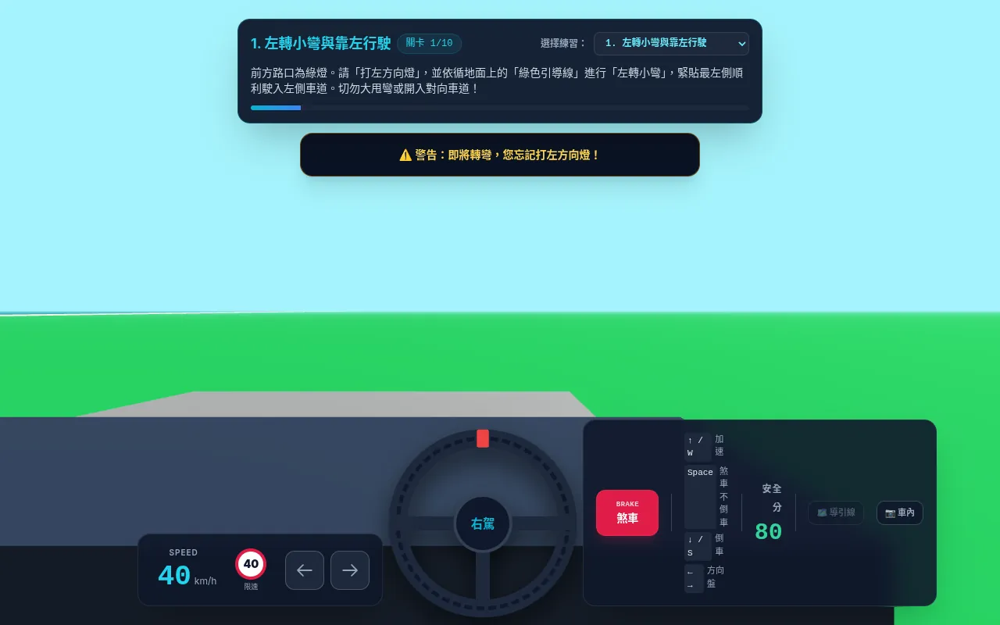
- **工作量**：S

### B2. 紅綠燈左右順序與日本法規相反（P0／S）
- **現況與證據**
  - 程式把紅燈放在 x=-7（駕駛看過去在左），綠燈放在 x=-5（右）（第 1591–1604 行）。實際畫面：`zoom-01-signal-red-on-left.webp`、`desktop-07-l7-signal-order-stopsign-npc.webp`。
  - 日本《道路交通法施行令》第 3 條規定，橫式號誌**由左至右為青、黃、赤**，紅燈在靠道路中央的右側。箭頭燈則是左轉在青燈下方、直行在黃燈下方、右轉在赤燈下方。
    - 參考：JAF https://jaf.or.jp/common/kuruma-qa/category-drive/subcategory-sign/faq166
    - 參考：維基百科「日本の交通信号機」https://ja.wikipedia.org/wiki/日本の交通信号機
  - 目前箭頭順序（← ↑ →）是對的，但三色燈反了，所以「紅燈＋右轉箭頭」看起來是「左邊紅燈，右邊綠箭頭」，跟實際上路時的視覺記憶不同。
- **建議做法**：對調 `redLens` 和 `greenLens` 的 x 座標（以及對應的光暈 `glowSpecs`）。

  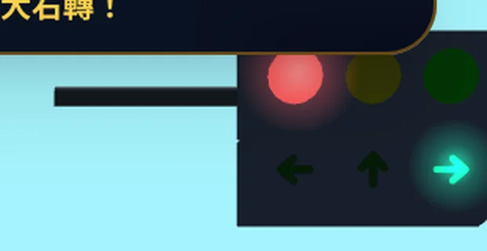
- **效益**：教學正確性。這是給旅客「建立視覺記憶」的工具，位置錯了會有負面學習效果。
- **工作量**：S（4 個數字）

### B3. 場景誤導：所有關卡都有「止まれ」，對向車停錯位置（P1／S）
- **現況與證據**
  - 「止まれ」路面字和三角牌在 `buildEnvironment` 中無條件加入（第 1026–1038 行）。結果第 1、2、4、7 等有號誌的關卡也看得到停止標誌，與「無號誌路口才有一時停止」的教學互相矛盾：`desktop-07-l7-signal-order-stopsign-npc.webp`。
  - 第 7 關對向車設在 `(4, 0, 12)`，註解寫「Stop before line」（第 692–694 行），但 z=12 其實是**已經穿過路口、停在我方這一側的斑馬線上**。對向車的停止線應在 z≈-15。畫面上那台藍車就停在玩家右前方的斑馬線上：`desktop-07…`、`landscape-01-l7-hud-dash-cover-road.webp`。
- **建議做法**
  - 「止まれ」只在第 3 關（和之後的一時停止關）顯示，有號誌的關卡隱藏。
  - 對向車移到 z≈-17 停等。
- **效益**：畫面和規則一致，避免玩家誤以為「有號誌也要一時停止」。
- **工作量**：S

### B4. 難度曲線平，關卡重複（P1／M）
- **現況與證據**
  - 10 關都從同一路口南側出發，起點都在 z=50–55（各關 `setup`）。
  - 路徑只有 3 種：導引線程式中，第 1、4、9 關共用左轉，第 2、7 關共用右轉，第 3、6、8、10 關直行（第 1702–1726 行）。
  - 第 3 關和第 6 關的判定程式幾乎一樣（第 544–575 行與第 653–682 行）。
  - 號誌在 `setup` 設定後整關都不變，沒有「綠→黃→紅」的兩難情境。
  - 第 9 關「綜合號誌大考驗」實際上就是第 4 關的左轉。
  - 整個遊戲只有第 2、7 關有 1 台 NPC，第 10 關有 1 位行人。
- **建議做法**
  - 第 9 關改成隨機箭頭組合，例如有時只亮直行箭頭，想左轉就判違規，玩家必須「看燈判斷」而不是背答案。
  - 加入會變化的號誌週期（右轉箭頭依序亮起、黃燈兩難）。
  - 後段關卡加入多台 NPC 和行人。
  - 新增「考試模式」：隨機抽 5 關，不給導引線也不給 HUD 提示。
- **效益**：遊玩時間和重玩價值提升，也更接近真實路況。
- **工作量**：M

### B5. 缺少沖繩在地情境關卡（P1／L，屬新增內容建議）
- **現況與證據**：目前 10 關都是通用的日本號誌題型。倒車鍵（↓／S、「倒」）已經實作，但沒有任何關卡用到倒車（第 436–836 行 `scenarios` 中沒有相關判定）。
- **建議做法**（以下為內容提案，非缺陷）
  - **巴士專用道**：58 號線等路段在尖峰時段禁止一般車輛進入。
  - **左轉捲入**：左轉時左後方有機車或自行車。
  - **右轉專用道＋右轉待轉**：多台對向車連續通過。
  - **停車場倒車入庫**：可以用到現有的倒車鍵。
  - **狹窄巷弄會車**、**一方通行**、**夜間或雨天**。
- **效益**：差異化的「沖繩」賣點，和旅客實際最容易出錯的情境直接相關。
- **工作量**：L（每關 M）

### B6. 部分判定與法規教學有疑慮（P1／S，建議查證後再改）
- **現況與證據**
  - 第 5 關閃爍黃燈：只要起步後在路口前速度降到 0，就直接判失敗（第 627–628 行）。但日本法規中，閃爍黃燈是「注意其他交通後可以前進」，停下來並不違規。教學上更適合「提示加輕微扣分」。
  - 第 4 關說明「依日本法規，左轉車輛擁有優先通行權」（第 579 行）用詞可能誤導。綠箭頭代表「可以通行」，不代表凌駕行人或其他用路人。（推測，需要查證法規原文）
  - 第 3、6 關的停止判定區只有 z 17.5–21.5（4 個單位，第 548、656 行）。我在 z=25.3（「止まれ」字前方，視覺上合理的位置）完全停下，系統完全沒有反應（見 C5）。
- **建議做法**
  - 請熟悉日本駕訓的人校對 10 關文案。
  - 第 5 關改成「停車扣 5 分並提示」。
  - 停止區放寬到停止線前 0–6 公尺。
- **效益**：避免教錯規則，判定也比較符合直覺。
- **工作量**：S

### B7. 計分跨關累積，和星等脫鉤，沒有結算（P2／M）
- **現況與證據**
  - `score` 是全域變數，跨關累積（第 362 行）。失敗扣 15 分（第 1993 行），只有在「畢業」後才重置（第 1980 行）。
  - 實測：第 1 關因為測試超速，安全分掉到 80，但重開同一關完美通過仍拿 3 星（`desktop-08-l1-success-modal.webp`）。這時儀表板顯示 80 分配 3 星，玩家難以理解兩者的關係。
  - 沒有結算頁和錯誤清單。
- **建議做法**
  - 儀表板改顯示「本關分數」。
  - 全部關卡結束後出結算頁：各關星等、總分、最常犯的錯，以及「再練一次」的錯題清單。
  - 可選做一張分享卡片。
- **效益**：回饋更清楚，也增加重玩動機。
- **工作量**：M

---

## C. 操控手感

> 實測數據（桌機鍵盤，第 1 關直路）：0→40 km/h 約 **1.9 秒**；全油門極速 50 km/h（約 3.2 秒）；從起點到停止線（35 單位）約 **2.2 秒**；38 km/h 放開油門滑行到停止需 **2.38 秒／11.65 單位**；38 km/h 煞到 0 只需 **0.22 秒／1.07 單位**。

### C1. 鍵盤沒有方向燈快捷鍵（P0／S）
- **現況與證據**
  - 方向燈只能用滑鼠點按鈕（第 221–226 行的 `onclick`）。鍵盤事件只記錄方向鍵、WASD 和空白鍵（第 1772–1790 行）。
  - 實測按 Q、E 後 `car.indicator` 仍是 `null`。
  - 桌機玩家要一手按 ↑ 加速，另一手放開方向鍵去拿滑鼠打燈，但每個轉彎關都要求打方向燈。
- **建議做法**：加 `Q／E`（或 `Z／X`）切換左右方向燈，`C` 切換視角，`G` 切換導引線，並寫進鍵位提示和 README。
- **效益**：桌機的核心操作流暢度大幅提升，「忘記打方向燈」的扣分也比較公平。
- **工作量**：S

### C2. 按鍵會卡住，車子會自己一直加速（P0／S）
- **現況與證據**
  - **切視窗**：按住 W 時切換分頁或視窗，`keyup` 不會送達，而程式沒有處理 `blur` 或 `visibilitychange`（第 1772–1790 行）。實測發出 `blur` 事件後 `keys['w']` 仍是 `true`，車速 1.5 秒內從 15 升到 41 km/h，同時開始超速扣分。
  - **大小寫**：以 `e.key` 為鍵值，按下時是 `w`、放開時若按著 Shift 會變成 `W`，`keys['w']` 就永遠是 `true`（實測確認）。
  - 也沒有暫停鍵：實測按 Esc 後 `isDriving` 仍是 `true`。
- **建議做法**
  - 改用 `e.code`（`KeyW`、`ArrowUp`）。
  - 在 `blur`、`visibilitychange` 時清空 `keys` 並自動暫停。
  - 加 Esc 暫停選單（繼續、重來、選關、靜音）。
- **效益**：消除「車子自己暴衝」的嚴重手感問題。
- **工作量**：S

### C3. 煞車太瞬間，滑行阻力太大（P1／S）
- **現況與證據**
  - 煞車每幀同時減 0.02，再乘上 0.90（第 2016–2026 行）。38 km/h 只要 0.22 秒、1.07 單位就停住，等同「瞬間停車」，學不到煞車距離。
  - 放開油門時每幀乘 0.97（第 2036 行），2.4 秒內就停下，像一直在踩煞車，很難做到第 5 關要求的「慢速滑行通過」。
- **建議做法**
  - 煞車改成「按住越久越強」的漸進曲線，減速度約 0.5–0.7 g。
  - 滑行阻力改到 0.995 左右。
  - 可選：在 HUD 顯示「預估停車距離」。
- **效益**：真實的停車手感，第 3、6、10 關「在線前停好」才有技巧性。
- **工作量**：S（調參數，需要搭配 C4 一起調）

### C4. 速度單位與世界比例不一致，進場距離太短（P1／M）
- **現況與證據**
  - 儀表顯示 `speed × 100` km/h（第 2090 行），但車子每秒移動 `speed × 60` 單位（第 2065–2066 行）。顯示 40 km/h 時每秒移動 24 單位；若 1 單位等於 1 公尺，實際約是 86 km/h。
  - 車道寬 8 單位（道路寬 16，第 991 行），日本一般車道寬約 3–3.5 公尺，兩者比例也對不上。
  - 實測從起點全油門 2.2 秒就越過停止線，玩家幾乎沒有時間讀燈、打燈和減速。
- **建議做法**
  - 統一定義 1 單位等於 1 公尺，車道寬約 3.5。
  - 起點拉到停止線前 80–120 公尺。
  - 0→40 km/h 調整到約 4–5 秒。
- **效益**：速度感與真實駕駛一致，留出「觀察、判斷、操作」的時間，這正是教學重點。
- **工作量**：M（牽涉所有關卡座標，需要回歸測試）

### C5. 停車位置沒有回饋（P1／S）
- **現況與證據**
  - 停止判定區是 z 17.5–21.5（第 548、656 行）。實測在 z=25.3 完全停下，HUD 仍是「準備煞停」，沒有任何「再往前一點」的提示：`desktop-04-l3-stopped-early-no-feedback.webp`。
  - 停在判定區內時，白色停止線已經被引擎蓋擋住（同一張圖和 `mobile-03-…`），玩家無法目測自己離線多遠。
  - 紅色停車點只在導引線打開時才出現（第 1750 行）。
- **建議做法**
  - HUD 加「距停止線 X m」小量表（綠、黃、紅三段）。
  - 太早停時提示「請緩慢前進至白線前」。
  - 進入停止區時引擎蓋半透明，或讓相機稍微往下看。
- **效益**：減少「我明明停了為什麼失敗」的挫折。
- **工作量**：S

### C6. 轉向只有數位開關，手機只能用 ◀ ▶（P1／M）
- **現況與證據**
  - 鍵盤和觸控都是開關式轉向：每幀 +0.005，最多 0.07 × 車速係數（第 2045–2059 行），約 0.23 秒就轉到底，無法微調。
  - 桌機畫面上的 3D 方向盤有 `pointer-events-auto`（第 231 行），但沒有綁任何拖曳事件，只是裝飾。
  - 左轉的成功判定窗口是通過 x=-10 時 z 在 0–8 之間（第 463 行）。我的自動駕駛腳本在約 15 fps 的軟體渲染下，直式手機一次轉太寬失敗（z=-1.5），橫式成功。
    - 推測：在低階手機上，開關式轉向加上窄判定窗，會讓左轉關的難度明顯偏高。
- **建議做法**
  - 手機：改成可左右拖曳的方向盤或滑桿（類比值），並提供陀螺儀傾斜轉向選項（DeviceOrientation，需要權限）。
  - 桌機：方向盤可以用滑鼠拖曳。
  - 支援 Gamepad API，讓搖桿和方向盤控制器可以用。
- **效益**：轉彎能「畫出弧線」，大彎、小彎的差異才練得出來。
- **工作量**：M

### C7. 缺少右駕特有手感：撥桿與雨刷（P2／M，屬加分提案）
- **現況與證據**：右駕日本車的方向燈撥桿在方向盤**右側**、雨刷在左側，習慣左駕的旅客最常「想打方向燈卻開了雨刷」。這是右駕最具代表性的經驗，但目前方向燈只是儀表板上的兩個按鈕（第 219–227 行）。
- **建議做法**
  - 在方向盤右側放一根「方向燈撥桿」（上撥右轉、下撥左轉），左側放「雨刷撥桿」。
  - 誤觸雨刷時播放雨刷動畫和音效，並提示一次。
  - Android 可以搭配 `navigator.vibrate` 給違規震動回饋。
- **效益**：獨特又好笑的記憶點，也是最貼近「右駕練習」的手感。
- **工作量**：M

---

## 截圖索引

| 檔案 | 對應項目 | 內容 |
|---|---|---|
| 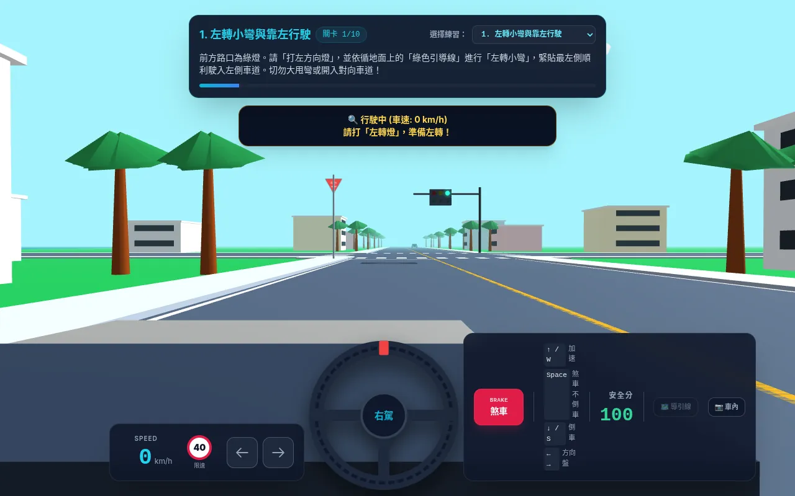 | A3 | 桌機第 1 關初始 HUD，鍵位提示一字一行 |
| 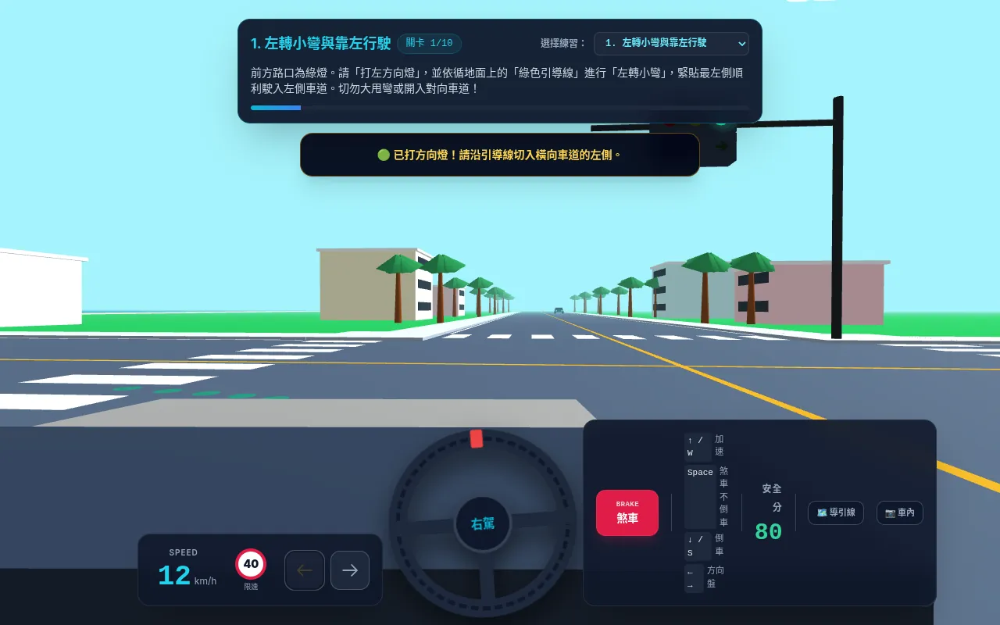 | A1、A4 | 過停止線時號誌被卡片切掉，導引點很淡 |
|  | A1 | 停止線前 HUD 指示條完全蓋住紅綠燈 |
| 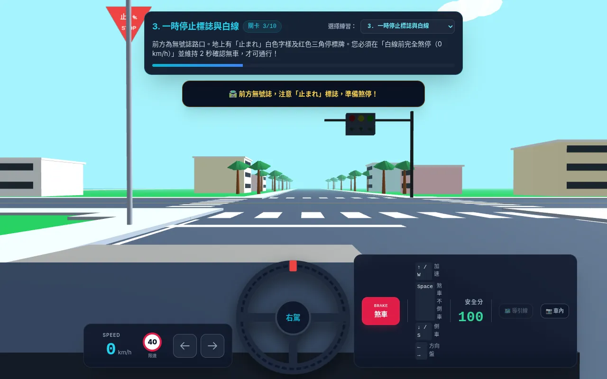 | A1、C5、B6 | z=25.3 停車沒有回饋，「止まれ」牌被卡片遮住 |
|  | A7 | 一時停止失敗卻提醒轉彎規則 |
|  | B1 | 直行開出地圖，關卡沒有結束 |
| 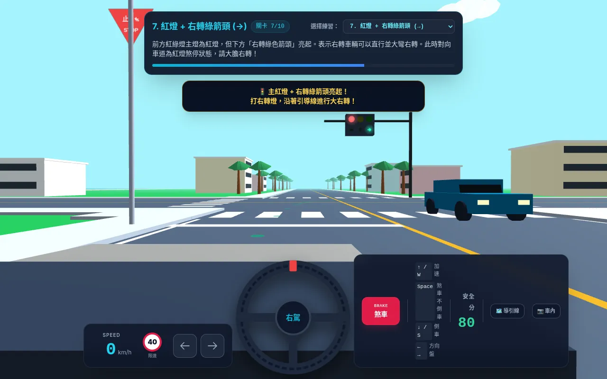 | B2、B3、A3 | 紅燈在左；號誌關卡出現「止まれ」；對向車停在我方斑馬線；「安全分」斷行 |
|  | A7、B7 | 過關彈窗只有「下一關」；3 星但安全分 80 |
| 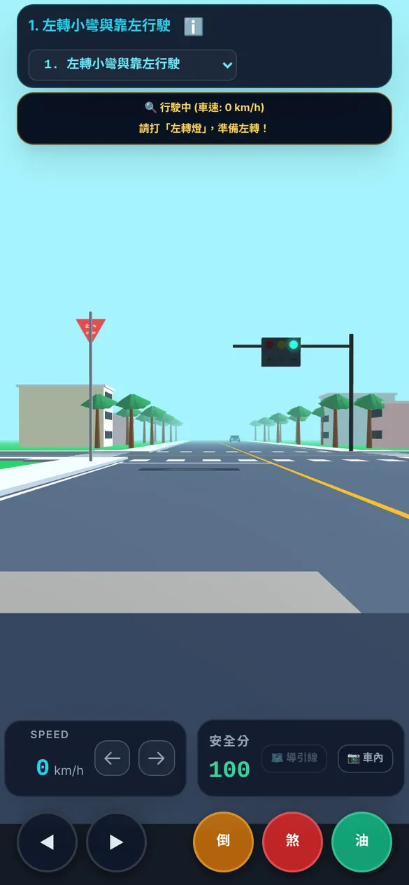 | A5 | 手機直式初始 HUD 與觸控按鈕配置 |
| 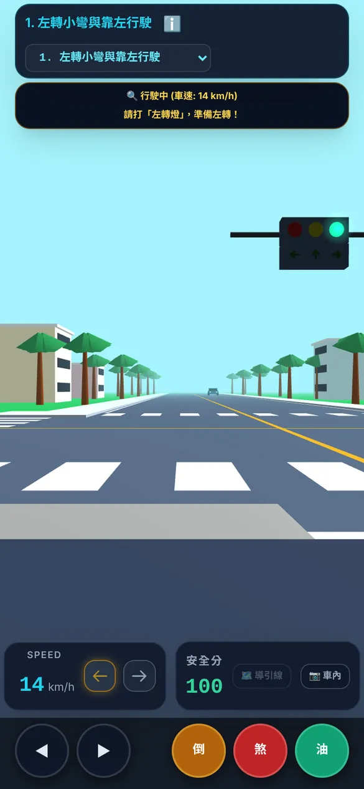 | A7 | 已打左轉燈，HUD 仍要求打燈 |
| 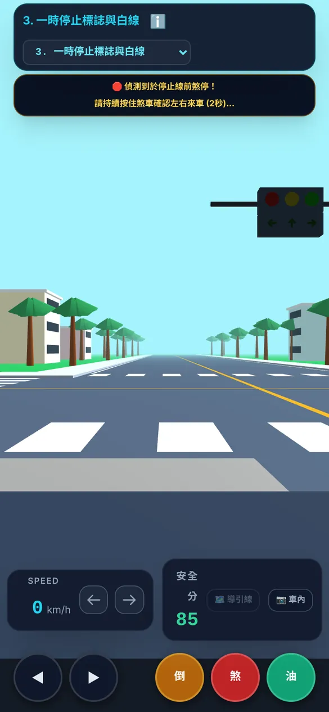 | A2、C5 | 直式停止區：看不到「止まれ」和左右路口 |
| 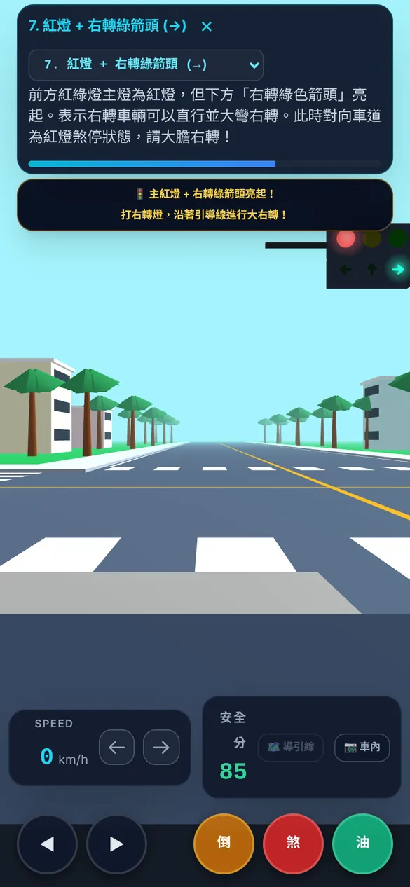 | A1 | 展開說明後指示條壓到號誌 |
| 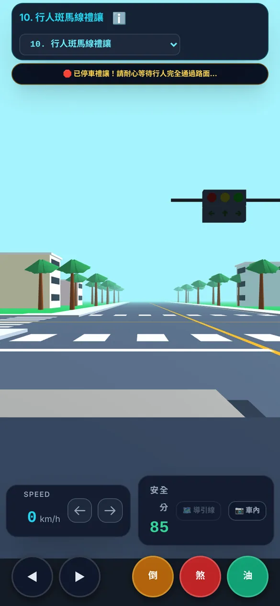 | A2 | 「已停車禮讓」但畫面上沒有行人 |
|  | A2 | 行人在路中央時只露出半身在右緣 |
| 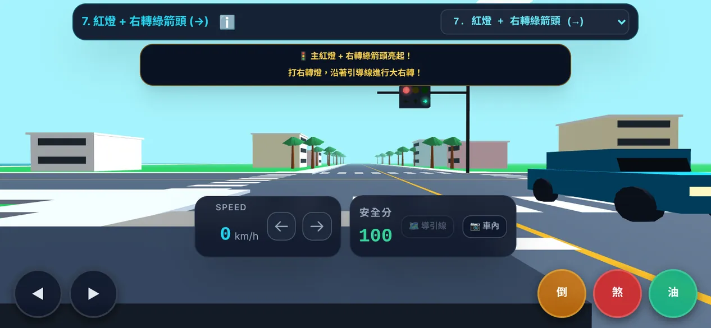 | A1、B3 | 橫式：指示條貼著燈，儀表板疊在路面中央 |
| 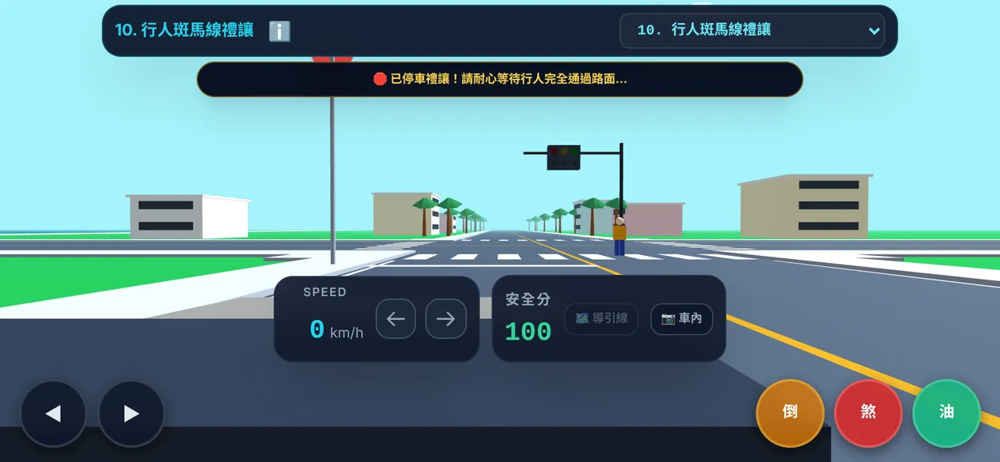 | A2 | 對照：橫式看得到行人 |
|  | B2 | 號誌特寫：紅、黃、綠由左至右 |

## 其他觀察（不在三個方向內，給 Roger 參考）

- 依賴 `cdn.tailwindcss.com`（第 7 行）。主控台會出現「should not be used in production」警告，且每次載入都在瀏覽器端編譯 CSS。另外還有 2 個 404 資源錯誤（實測主控台）。離線或網路差時版面會壞。建議改用建置好的 CSS 檔。
- 效能：場景有 435 個 mesh，每幀約 251 次 draw call、3,782 個三角形。陰影相機只涵蓋 ±5 單位（512px），開了 `shadowMap` 卻幾乎看不到陰影，仍要付出陰影渲染的成本（推測）。
  - 本次是 SwiftShader 軟體渲染，桌機約 16–17 fps、手機約 15 fps，**不代表真機效能**。真機 fps 未驗證。

## 測試環境與未驗證項目

- **環境**：Chrome（headless）、SwiftShader WebGL；Playwright 鍵盤和 CDP 觸控事件。
- **實際玩到**
  - 桌機：第 1 關（過關、直行卡關、加速／滑行／煞車量測）、第 2 關（禮讓後右轉過關）、第 3 關（過關、太早停、越線失敗）、第 5 關（卡鍵測試）、第 7 關（號誌近照）。
  - 手機直式和橫式：第 1 關（直式轉太寬失敗、橫式過關）、第 3 關（過關）、第 7 關、第 10 關（禮讓後畢業）。
- **未實際玩到**：第 4、6、8、9 關，只做程式碼審閱，判定邏輯與第 1、3 關相同。
- **未驗證**
  - 真機效能（iPhone Safari、Android Chrome）。
  - 真實多指觸控：CDP 模擬多指時，放開的順序與真機不同，所以我改成「全部放開再重按」來模擬，沒有發現遊戲端的多指 bug，但也沒辦法完全證明沒有。
  - 音效實際聽感（headless 環境沒有聲音）。
  - 螢幕閱讀器實際朗讀效果。
  - B6 的法規細節（需要人工查證）。
- **原始量測資料**：box 上的 `/workspace/okinawa-hc/play/desktop.json`、`mobile.json`。
