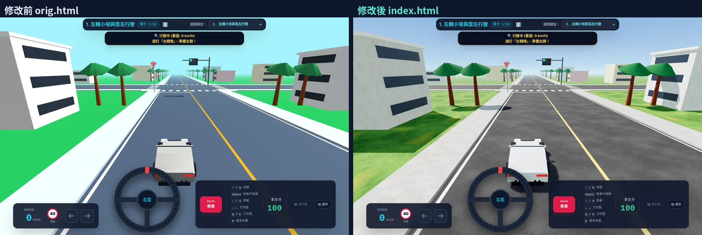
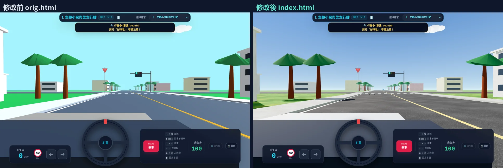
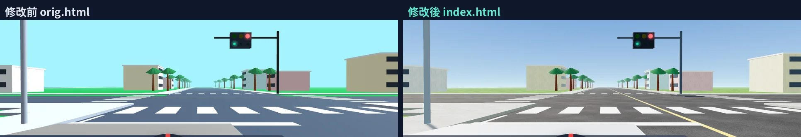
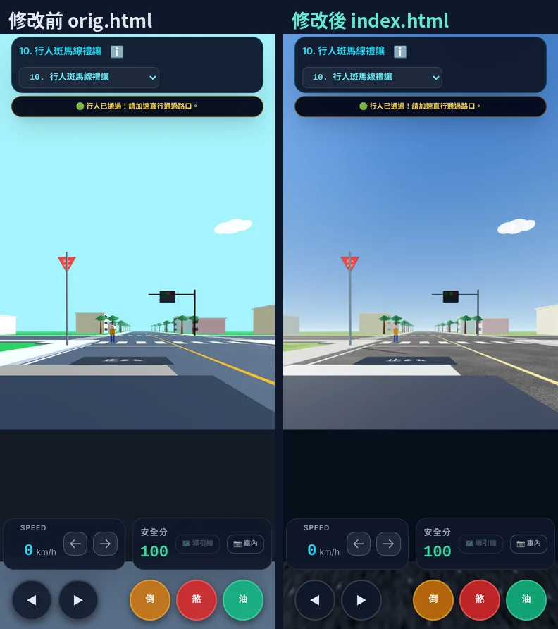

# Okinawa 右駕模擬器：畫面擬真升級（2026-11-17）

- 修改檔案：`index.html`（原檔另存為 `orig.html`，沒有覆蓋）
- 範圍：只改 3D 渲染。遊戲邏輯、關卡判定、HUD、操控都沒動
- 沒有加入外部圖檔、字型或新的 CDN，材質全部用 Canvas 即時產生；three.js 維持 CDN r128

## 1. 「像素感」從哪裡來

在 Playwright（Chromium + SwiftShader）用原版截圖比對後，主要來源依影響大小排列：

1. **大面積純色**：草地 `#15803d`、路面 `#334155`、人行道 `#94a3b8`、天空 `#a5f3fc` 都是單色。沒有任何紋理，畫面像色塊拼貼，看起來很「像素」也很「玩具」。
2. **色彩管線不正確**：沒有 sRGB 輸出和 tone mapping，光影過渡生硬，顏色過飽和（草地是螢光綠）。
3. **平均的 AmbientLight 0.65**：物體沒有上下明暗差，立體感很弱。
4. **陰影幾乎看不到**：預設 512 解析度的 shadow map，shadow camera 只涵蓋原點附近 ±5m，玩家附近基本上沒有陰影；PCF 鋸齒也重。
5. **幾何面數低**：輪胎 14 段、輪圈 10 段、燈杆 8 段、棕櫚樹幹 6 段、樹冠 5 段，近看時邊緣有明顯稜角。

## 2. 改了什麼、為什麼

| 項目 | 改法 | 原因 |
|---|---|---|
| Renderer | `outputEncoding = sRGBEncoding`、`ACESFilmicToneMapping`（曝光 0.92）、`PCFSoftShadowMap` | 正確的色彩空間和電影級色調，讓亮部不爆、陰影柔和 |
| 色彩保真 | 新增 `applyRealisticMaterials()`：所有材質色轉線性空間，畫面上的色相與原設計一致；`setLinHex()` 用於號誌的動態換色 | r128 沒有 ColorManagement，不轉的話開 sRGB 後顏色會整片變淡 |
| 號誌、標誌 | MeshBasic 與 Sprite 一律設 `toneMapped = false` | 保留紅、黃、綠燈的發光外觀，不會被 tone mapping 壓灰 |
| 陰影 | 桌機 2048、觸控 1024；shadow camera ±30m（約 60m）且每幀跟著車移動（光源 position 和 target 一起移）；`bias -0.0004`、`normalBias 0.03`；非平面物件自動 cast，標準材質自動 receive | 玩家附近都有清楚柔和的陰影，沒有條紋 |
| 光線 | `HemisphereLight`（天空藍 / 草地綠，0.55）＋少量 AmbientLight 0.08；太陽改暖色 `#ffe7c2`，位置改到左前上方 | 物體上亮下暗；樹和桿子的影子會落在前方路面，從駕駛座看得到 |
| 環境反射 | `PMREMGenerator` 從天空漸層產生 `scene.environment`；金屬（車漆、輪圈、號誌杆）反射強度 1.0，其他 0.35 | 車漆、玻璃、金屬有天空反光 |
| 天空 | Shader 漸層天空球（天頂 `#2f6fc4` → 地平線 `#d6ecf5`），含柔和太陽光暈，每幀跟著攝影機；霧色與地平線同色 | 取代單色背景，遠景自然融入 |
| 程序化材質 | 柏油（骨材顆粒＋色斑＋bump）、草地（多層綠色雜訊＋草紋，地面再加頂點色做大範圍明暗）、人行道 0.5m 方磚（每塊色差＋灰縫＋bump）、建築灰泥牆（雨痕） | 消除大面積純色的「像素感」 |
| 貼圖品質 | `RepeatWrapping`、mipmap、`LinearMipmapLinearFilter`、anisotropy（`getMaxAnisotropy()`，上限 8） | 遠處路面不閃爍、斜角不糊 |
| 標線 | 中央線、白線、停止線、斑馬線改用 `MeshStandardMaterial`（roughness 0.6，微量 emissive 維持可讀性）＋ `polygonOffset` | 會受光影影響，像真的油漆；避免 z-fighting |
| 幾何 | 輪胎 32、輪圈 24、NPC 車輪 28、排氣管 16、樹幹 12、樹冠 10、燈杆 20、號誌燈 32、雲 20×14、導引點 20；行人的身體和腿改成圓柱、頭 20×16 | 近看不再有明顯稜角 |
| 效能降級 | 觸控裝置：pixelRatio 上限 1.5（桌機維持 2）、陰影 1024、幾何段數 ×0.6、程序材質 256px（桌機 512px） | 手機上維持流暢 |

## 3. 對照圖

最能展示效果的是車外視角（陰影、柏油、草地、天空一次看得到）：

第 1 關開局（桌機，車內視角）：

第 4 關號誌近照（確認紅燈、左轉綠箭頭依然鮮明）：

第 10 關行人（手機直式 390×844）：

單張截圖（`-before` 是原版，`-after` 是新版）：

| 場景 | 桌機 1280×800 | 手機直式 390×844 |
|---|---|---|
| 第 1 關開局 | [before](visual-img/desk-L1-start-before.webp)／[after](visual-img/desk-L1-start-after.webp) | [before](visual-img/mob-L1-start-before.webp)／[after](visual-img/mob-L1-start-after.webp) |
| 第 3 關接近一時停止標誌 | [before](visual-img/desk-L3-stopsign-before.webp)／[after](visual-img/desk-L3-stopsign-after.webp) | [before](visual-img/mob-L3-stopsign-before.webp)／[after](visual-img/mob-L3-stopsign-after.webp) |
| 第 4 關接近號誌 | [before](visual-img/desk-L4-signal-before.webp)／[after](visual-img/desk-L4-signal-after.webp) | [before](visual-img/mob-L4-signal-before.webp)／[after](visual-img/mob-L4-signal-after.webp) |
| 第 10 關行人 | [before](visual-img/desk-L10-ped-before.webp)／[after](visual-img/desk-L10-ped-after.webp) | [before](visual-img/mob-L10-ped-before.webp)／[after](visual-img/mob-L10-ped-after.webp) |
| 第 1 關車外視角 | [before](visual-img/desk-L1-chase-before.webp)／[after](visual-img/desk-L1-chase-after.webp) | [before](visual-img/mob-L1-chase-before.webp)／[after](visual-img/mob-L1-chase-after.webp) |

註：第 3 關沒有紅綠燈（是一時停止標誌），所以另外加了第 4 關的號誌截圖。

## 4. 效能影響

**box 沒有 GPU**，以下是 SwiftShader 軟體渲染的數字，只能看相對變化，不代表實機 fps。

| 環境 | 原版 | 新版 | 變化 |
|---|---|---|---|
| 桌機 1280×800（pixelRatio 1） | 17.5 fps | 4.1 fps | 約 −75% |
| 手機 390×844（觸控降級，pixelRatio 1.5） | 17.3 fps | 6.7 fps | 約 −60% |
| 每幀三角形（桌機） | 約 3.8k | 約 15k | 主要來自地面細分 50×50 和高段數幾何 |
| Draw calls | 251 | 252 | 幾乎不變 |
| 啟動到可開車 | 約 1.5 s | 約 3.5–4.2 s | 程序化材質在載入時產生（CPU 運算，實機會更快） |

軟體渲染下最貴的是 PCFSoft 陰影（每個像素多次取樣）和 2048 shadow map，這兩項在實體 GPU 上成本很低。15k 三角形和 252 draw calls 對任何有 GPU 的手機都屬輕量。

如果實機上手機仍覺得卡，可以再調 `GFX` 物件（`index.html` 開頭的視覺升級區塊），例如把 `shadowMapSize` 降到 512 或把 `pixelRatioCap` 降到 1.25。

## 5. 回歸測試

用 Playwright 自動駕駛實際開完（不是直接設座標），桌機鍵盤操作，手機用觸控按鈕：

| 關卡 | 桌機 1280×800 | 手機直式 390×844 |
|---|---|---|
| 第 1 關 左轉小彎 | 通關 ⭐⭐⭐ | 通關 ⭐⭐⭐ |
| 第 2 關 右轉大彎禮讓 | 通關 ⭐⭐⭐ | 通關 ⭐⭐⭐ |
| 第 3 關 一時停止 | 通關 ⭐⭐⭐ | 通關 ⭐⭐⭐ |
| 第 10 關 行人禮讓 | 通關（恭喜畢業）⭐⭐⭐ | 通關（恭喜畢業）⭐⭐⭐ |

Console：沒有 JavaScript 錯誤或 pageerror。只有兩種既有訊息，原版也有：Tailwind CDN 的 production 警告，以及本機 server 沒有 `favicon.ico` 的 404。

## 6. 沒有驗證到的部分

- **只在 Chromium + SwiftShader 測過**。沒有實體 GPU，也沒有測 Safari、iOS 實機、Android 實機；實機的 fps、陰影品質和 anisotropy 效果需要 Roger 在 Mac 或手機上確認。
- 觸控降級靠 `maxTouchPoints` 加 `(pointer: coarse)` 或手機 UA 判斷；有觸控螢幕的筆電若被判成觸控，會用較低的畫質設定。
- 截圖的位置是用 `__simDebug` 直接設定車輛座標，不是真的開過去；第 10 關行人位置是手動放在斑馬線上。
- 白天以外的光線（黃昏、夜間）沒有做，原版也沒有。
- 沒逐一確認每一棵樹、每一棟建築的陰影都無條紋，只看了截圖中的範圍。
